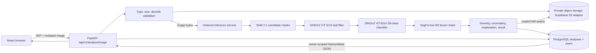

# PlantGuard AI Repository Audit

Audit date: 2026-10-27
Audited checkout: `C:\Users\Asus\PLANTGUARD AI`
Scope: source, configuration, manifests, scripts, migrations, tests, frontend and deployment files. Secret values and checkpoint tensors were not printed or deserialized. Existing dirty/untracked work was present before this audit and is preserved.

## Executive summary

The repository contains a substantial React/FastAPI application, authenticated scan lifecycle, PostgreSQL models/migrations, local/R2/Supabase-compatible object storage, and an ordered real-model inference implementation. It is **not yet production-ready or verified end to end**.

The local checkpoint copy is now concrete: the user ran the bounded hash-manifest script and it reported `checksums_recorded`, 4 artifacts, 773,309,288 bytes. The source/destination hashes also matched. This establishes byte identity for the copied files, not checkpoint provenance, model quality, or successful loading.

The central remaining blocker is inference-runtime integration and validation. The inspected Python 3.12 environment has PyTorch, torchvision, Transformers and safetensors, but lacks SAM 2, Hydra, iopath, OpenCV and ONNX Runtime. The Python 3.14 API environment has FastAPI but no PyTorch/Transformers. The configured SAM adapter is real SAM 2 code and fails closed; it has not been smoke-tested with the checkpoint.

## Architecture and current data flow

The upload route stores the original image, persists a pending analysis row, runs inference in an ASGI threadpool, then persists a completed result or a safe failure record. The result UI reads the lifecycle API. The code creates the analysis service for each upload; adapters load lazily and are unloaded after each stage, so weights are reloaded for later requests. This protects peak memory but adds substantial per-request startup cost.

The Vite/Express starter server exposes `/api/ping` and `/api/demo`. The local Vite config now proxies `/api` to FastAPI before the Express middleware. Client calls still use `VITE_API_URL || ""`; production therefore needs an explicit API URL and hosting/routing for FastAPI. The Netlify function wraps the Express starter, not FastAPI.

## Model and ML stage inventory

| Order / component | Task and implementation | Input and preprocessing | Output | Weights / size | Status |
|---|---|---|---|---|---|
| 1. SAM 2.1 Hiera Base Plus | SAM2 automatic candidate mask generator; geometric candidate pruning | RGB uint8 H×W×3; service accepts up to 8192 px per side / 32 MP. CPU uses an 8×8 prompt grid; CUDA strategy can use denser sampling. | Candidate masks, normalized boxes, SAM quality score | `artifacts/sam2/sam2.1_hiera_base_plus.pt`, 323,606,802 bytes; SHA recorded | Implemented, real inference blocked: SAM2 package/config not installed in inspected CPU environment. No substitute masks. CPU memory/latency and candidate quality unmeasured. |
| 2. DINOv2 ViT-S/14 leaf filter | Custom native-PyTorch ViT-S/14 binary head | RGB 224×224, ImageNet mean/std | Negative/positive probabilities; positive ≥0.5 accepts a candidate | `artifacts/dino_leaf_filter/dino_leaf_filter_v2.pt`, 88,300,869 bytes; SHA recorded | Implemented, checkpoint not loaded. V2 training provenance and matching evaluation are unverified; historical evaluation references v1. |
| 3. DINOv2 ViT-B/14 classifier | Custom native-PyTorch ViT-B/14, 38 classes | RGB 224×224, ImageNet mean/std | 38-way softmax, top 5 class probabilities | `artifacts/dino_disease/dino_disease_classifier.pt`, 346,516,841 bytes; SHA recorded; 38 labels in `artifacts/dino_disease/classes.json` | Implemented, checkpoint/output not smoke-tested; training provenance and calibration are unverified. |
| 4. SegFormer-B0 PlantSeg | Transformers `SegformerForSemanticSegmentation` | RGB crop, preprocessing metadata says 512×512, ImageNet mean/std | Background/diseased-region class mask resized to crop dimensions | `outputs/segformer_plantseg/best_model/model.safetensors`, 14,884,776 bytes; SHA recorded | Implemented, checkpoint not loaded. Config says image_size=224 while preprocessing says 512; confirm the training path before interpreting predictions. Historical Dice 0.787 is not independently reproduced. |
| 5. Severity / reliability / explainability / assembly | Mask intersection and pixel ratio; entropy/MSP threshold; gradient-weighted final-block DINO attention | SegFormer lesion mask intersected with SAM leaf mask; classifier raw softmax | Severity %, provisional band, uncertainty flags, optional stored heatmap and structured result | Code/config artifacts; no separate trained weights | Code exists but calibration, agronomic thresholds, CAM quality and complete asset URL flow are unvalidated. |

The custom DINO backbone exposes one CLS token and 256 patch tokens at 224 px; its current CAM code checks 257×257 attention and reshapes the patch relevance to 16×16. No register tokens exist in this custom model. This does not establish CAM faithfulness. Probabilities are uncalibrated. The OOD path used by inference is normalized entropy/MSP and explicitly reports incomplete calibration; no fitted threshold artifact or calibration script/data was found. An energy helper exists but is not the configured inference decision. No ONNX/INT8 variant is registered.

## Repository findings

### Implemented

- FastAPI app, authenticated registration/login/current-user routes, Argon2 password hashing, signed JWTs and owner-scoped analysis retrieval.
- PostgreSQL SQLAlchemy models and Alembic chain through `0005_analysis_failure_data`.
- Local object storage plus explicit R2 and Supabase S3-compatible adapters. Runtime configuration inspection confirms DB, Supabase settings and JWT are configured; no secret values were read and no live storage/database operation was performed for this audit.
- Image MIME/content checks, 10 MB upload limit, Pillow decode/verification, per-request threadpool inference, bounded concurrency, typed model failures and safe public failure details.
- Strict checkpoint/mapping verification and ordered inference contracts; manifest now contains recorded SHA-256 values. Original checkpoints were not modified.
- React routes for authentication, upload, scan detail and analysis history; TypeScript API contracts include the lifecycle result/failure fields.

### Missing, disabled or incomplete functionality
- The root-level `app` namespace shim previously failed to resolve `app.core` from the repo root; it is fixed and the root import smoke check now passes.

- Legacy `/api/scan`, `/api/scans*` return 503; video returns 501; agentic analysis returns 503. These are explicit disabled endpoints, not working features.
- Frontend recommendations, weather, chat, profile and settings use a generic “Coming next” placeholder. Plants/settings pages expose unavailable states. No backing product APIs were found.
- Frontend upload has no camera capture, preview/crop hint or progress-by-stage. Results do not display mask/CAM images or signed links. No feedback flow exists.
- Storage now creates five-minute presigned GET URLs for Supabase/R2 and uses an authenticated owner-checked proxy for local files. Asset links include only keys referenced by the authorized analysis. The results page loads the original, leaf mask, lesion mask and CAM when present.
- An owner-scoped delete-analysis API now removes the original and referenced mask/CAM objects before deleting the row; failed storage cleanup retains the row for retry. No feedback/correction table or separate model-version table exists.
- No Postgres RLS/storage policy implementation was found. API-level ownership checks exist, but production database/storage policy enforcement and least-privilege roles are unverified.
- Inference has no durable worker/queue or restart recovery; a process interruption can leave a pending row. The configured timeout bounds waiting for the inference semaphore; it does not terminate a stage that exceeds its runtime.
- Service creation is per upload; sequential stages are unloaded after each request-stage, so requests pay model load costs repeatedly. There is no startup warmup/self-check or model cache policy.
- Inference decode now applies EXIF orientation before RGB conversion, with a CPU-safe regression test. New `/api/health`, `/api/ready`, and `/api/models` endpoints provide liveness, strict dependency readiness and path/secret-safe model metadata. `/api/ready` returns 503 when any required check fails; the current lazy sequential model policy leaves all adapters unloaded between requests, so persistent model readiness still requires an explicit startup/cache design. Cloud storage readiness uses a read-only `HeadBucket` probe; provider credentials must permit that operation. Remote inference readiness now accepts only the explicit `available` status, avoiding false positives from non-empty error statuses. There is still no resize policy beyond dimension rejection and model-stage resizing, no explicit blur or multi-leaf ambiguity rejection, and healthy-class lesion skipping is absent.
- `backend/app/core/config.py` does not define all inference variables present in `backend/.env.example`; several are read directly with `os.getenv`. This weakens central validation and per-profile configuration.
- Frontend uses relative API calls by default. The local Vite config now proxies `/api` to FastAPI; production must set `VITE_API_URL` and host/route the Python API. The current Netlify function does not host FastAPI.
- Migrations `0003` and `0004` add non-null owner/object-key columns without a backfill. Applying them to populated earlier tables may fail; verify actual migration state and data before production rollout. Migration 0005 exists locally but its live application was not verified.
- No Dockerfile, Compose file, Makefile, notebooks, CI workflow or root README was found. Frontend includes Netlify/Vite config only. There are both npm and pnpm lockfiles, plus a small backend npm lockfile with no corresponding backend Node package.
- No production rate limiting, request-ID middleware, Prometheus metrics, retention policy or deploy/load/security validation was found.
- No `TODO`/`FIXME` markers were found in the scanned production source. Explicit 503/501 handlers and frontend placeholders are listed above.

### Configuration and contract mismatches

- `backend/.env` exists and was inspected by key names/configured booleans only. It contains sensitive values; none are included here. `frontend/.env` lacks `VITE_API_URL`, while the client defaults to same-origin requests.
- The backend lifecycle contract stores `FullScanResult`; the frontend type covers most displayed fields but omits backend asset references such as `leaf_mask_asset`, segmentation `mask_asset`, and explanation `heatmap_asset`.
- Legacy `PlantAnalysisResponse`/TypeScript types remain alongside the active `FullScanResult` lifecycle contract; keep the active contract authoritative and remove or explicitly deprecate unused legacy types.
- The manifest now records hashes for all four checkpoints. Hashes establish byte identity only; official source origin and training lineage remain unverified.

## Verification after targeted repairs

- Local manifest command reported `checksums_recorded`, 4 artifacts, 773,309,288 bytes.
- Previous source/destination hash comparison reported all four local checkpoint copies match. No checkpoint was deserialized.
- After the local proxy repair, a live local request through Vite at `/api/ping` returned FastAPI's `pong`. Frontend typecheck passed, all 12 Vitest tests passed, and both client and server production bundles built successfully. Health/readiness/model endpoint tests pass without connecting to external services.
- The repo-root Python import smoke check passed. Backend suite after EXIF, readiness, remote-health and private-asset lifecycle changes: 208 passed, 6 skipped. The skips require explicit PostgreSQL connectivity or real-model opt-in on a compatible ML runtime; no real model inference has run. The Python 3.12 ML environment has Torch/Transformers/safetensors but lacks SAM2/Hydra/iopath/OpenCV/ONNX Runtime.
- No production database migration, cloud storage write, or checkpoint load was performed.

## Prioritized execution plan

1. **P0 — Contract and local run path:** the checkpoint manifest notes and React-to-FastAPI local routing have been corrected. Reconcile frontend asset fields; readiness endpoints now distinguish DB, storage, model prerequisites and actually loaded models; a startup model cache/validation policy is still needed for model readiness to become true.
2. **P0 — Core correctness:** CPU-safe backend and frontend suites pass after fixing the root import shim and a missing typed capability-error import. Image EXIF orientation is now normalized; add a deterministic resize policy, improve bounded execution semantics and analysis recovery. Keep inference sequential and fail-closed.
3. **P1 — Real-model baseline:** complete compatible CPU SAM2 dependencies or prove incompatibility; run one isolated model stage at a time with time/RSS caps; reconcile SegFormer preprocessing; run end-to-end inference on approved fixtures. Record latency/RAM and results without making quality claims from smoke tests.
4. **P1 — Persistence and assets:** signed links, owner-checked local asset delivery and owner-scoped deletion/cleanup are implemented. Add retention and feedback storage. Decide how Postgres RLS is enforced with the chosen auth/database roles.
5. **P2 — Reliability:** create held-out OOD/temperature calibration tooling and versioned artifacts; measure classifier/segmenter/SAM quality; add quality-gated ONNX/INT8 variants only if parity and accuracy criteria pass. No quantization result can be claimed before data and benchmarks exist.
6. **P2 — Production operations:** durable worker semantics, rate limiting, structured request IDs/logs, startup capability checks, metrics, graceful shutdown and recoverable migrations.
7. **P3 — Deployment/product:** Python CPU/GPU deployment images, local Compose with Postgres, frontend-to-API production configuration, CI, E2E browser flow, and either implement or remove unsupported product routes. Document exact hardware and manual setup.

## Manual inputs required before production claims

- Install a compatible SAM2 runtime and official config for the Windows/WSL2 target, then opt in to real-artifact smoke tests. The checkpoint hash is recorded; source authenticity is not verified.
- PlantVillage/PlantSeg held-out calibration/evaluation data and provenance for DINO-S v2 and the classifier/segmenter runs.
- Confirmation of Supabase bucket configuration, private bucket policies and production DB role/RLS strategy. Local settings are present, but live connectivity/policy was not checked.
- A production API host and frontend API URL. Netlify currently serves the Express starter only; it does not run FastAPI/PyTorch.
- Hardware target(s) and quality/latency acceptance thresholds for CPU/GPU/quantized profiles.
