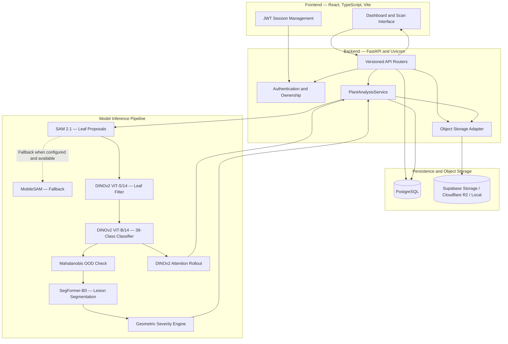

# PlantGuard AI

**A multi-stage computer-vision platform for plant health analysis**

PlantGuard AI is a plant-diagnostic web application that analyzes
uploaded leaf images through a sequential computer-vision pipeline. It
combines leaf candidate generation, leaf validation, 38-class disease
classification, out-of-distribution (OOD) reliability checks, lesion
segmentation, geometric severity estimation, and visual explainability.

The system is designed to avoid unsupported diagnoses: when a prediction
falls outside the calibrated OOD boundary or a required inference
component is unavailable, the result can be withheld and marked
`UNKNOWN` rather than presenting an unreliable disease label.

> **Project status:** This README documents the architecture, model
> artifacts, configuration, and workflows described for the project.
> Actual runtime readiness depends on the required checkpoints,
> environment variables, database migrations, storage credentials, and
> successful verification tests being present in the local deployment.

------------------------------------------------------------------------

## Contents

- [Highlights](#highlights)
- [Architecture](#architecture)
- [Inference pipeline](#inference-pipeline)
- [Technology stack](#technology-stack)
- [Repository layout](#repository-layout)
- [Requirements](#requirements)
- [Installation](#installation)
- [Configuration](#configuration)
- [Database setup](#database-setup)
- [Object-storage verification](#object-storage-verification)
- [Model artifacts](#model-artifacts)
- [Run the application](#run-the-application)
- [Scan lifecycle](#scan-lifecycle)
- [Testing](#testing)
- [Troubleshooting](#troubleshooting)
- [Limitations and future work](#limitations-and-future-work)
- [Security notes](#security-notes)

## Highlights

- **Multi-stage computer vision:** SAM 2.1, MobileSAM fallback, DINOv2
  leaf filtering, DINOv2 disease classification, and SegFormer-B0 lesion
  segmentation.
- **38 disease classes:** DINOv2 ViT-B/14 classifier with a
  768-dimensional CLS feature representation.
- **OOD reliability checks:** class-conditional Mahalanobis distance is
  compared with a calibrated threshold before accepting a diagnosis.
- **Mask-based severity:** severity is calculated from lesion pixels
  overlapping the valid leaf area, rather than from image-level
  classification confidence.
- **Visual explainability:** DINOv2 attention rollout provides an
  attention visualization.
- **Fail-closed behavior:** uncertain or unsupported predictions can be
  withheld instead of being converted into a confident diagnosis.
- **Persistent scan records:** PostgreSQL stores relational analysis
  data, while private object storage holds source and generated visual
  assets.
- **Owner-scoped access:** JWT authentication, Argon2 password hashing,
  and short-lived signed asset URLs.
- **Responsive web interface:** scan submission, scan status, result
  inspection, and historical analysis views.

## Architecture

The application is organized into a frontend, FastAPI backend,
persistence and storage layer, and a dedicated model-inference pipeline.



### Main components

| Layer          | Responsibility                                                                           |
|----------------|------------------------------------------------------------------------------------------|
| Frontend       | User interface, authentication state, scan submission, result visualization, and history |
| API            | Request validation, authentication, ownership checks, and application workflows          |
| ML service     | Coordinates model adapters and returns structured inference results                      |
| Model adapters | Encapsulate SAM, leaf filtering, classification, segmentation, and explainability        |
| PostgreSQL     | Stores users, plants, analyses, and relational metadata                                  |
| Object storage | Stores private source images and generated visual assets                                 |

## Inference pipeline

The model execution contract is implemented behind
`backend/app/ml/service.py`. The intended sequence is:

``` text
Input image (RGB)
       |
       v
1. SAM 2.1 Hiera Base Plus
   Candidate leaf-mask generation
   Fallback: MobileSAM ViT-T, when configured and available
       |
       v
2. DINOv2 ViT-S/14
   Leaf / non-leaf candidate filtering
       |
       v
3. DINOv2 ViT-B/14
   38-class disease classification
   768-dimensional CLS feature extraction
       |
       v
4. Mahalanobis OOD reliability check
   Compare feature distance with calibrated threshold
       |
       v
5. SegFormer-B0 PlantSeg
   Binary lesion segmentation
       |
       v
6. Geometric severity estimation
   Lesion pixels intersecting valid leaf pixels
   divided by valid leaf pixels
       |
       v
7. DINOv2 attention rollout
   Visual attention representation
       |
       v
8. Result validation and persistence
   PostgreSQL record + private visual assets
```

### Pipeline behavior

1.  SAM 2.1 proposes candidate leaf masks.
2.  Candidate duplicates are pruned according to the configured
    mask-processing logic.
3.  DINOv2 ViT-S/14 rejects candidates classified as non-leaf.
4.  DINOv2 ViT-B/14 predicts among the configured 38 classes and
    extracts the CLS representation.
5.  The OOD component evaluates the representation against the
    calibration artifact.
6.  SegFormer-B0 generates a binary lesion mask for accepted candidates.
7.  Severity is calculated from the overlap between the lesion mask and
    valid leaf pixels.
8.  The service assembles the result and associated visual assets for
    persistence and API response.

**OOD policy:** the threshold is calibration-dependent. A sample outside
the accepted boundary should not be treated as a reliable
in-distribution diagnosis. The documented reference threshold is
approximately `2474.64`; use the value stored in the deployed OOD
artifact as the source of truth.

## Technology stack

| Area                         | Technologies                                      |
|------------------------------|---------------------------------------------------|
| Frontend                     | React 18, TypeScript, Vite 8, Tailwind CSS        |
| Backend                      | Python, FastAPI, Uvicorn                          |
| Validation                   | Pydantic v2                                       |
| ORM and migrations           | SQLAlchemy, Alembic                               |
| Database                     | PostgreSQL                                        |
| Authentication               | JWT, Argon2                                       |
| Computer vision              | PyTorch, torchvision, Transformers                |
| Segmentation                 | SAM 2.1, MobileSAM, SegFormer-B0                  |
| Classification and filtering | DINOv2 ViT-S/14 and ViT-B/14                      |
| Object storage               | Supabase Storage, Cloudflare R2, or local storage |
| Testing                      | pytest, frontend type checks and test scripts     |

## Repository layout

``` text
PLANTGUARD-AI/
├── artifacts/
│   ├── dino_disease/             # Classifier, class mapping, OOD artifacts
│   ├── dino_leaf_filter/         # DINOv2 leaf-filter checkpoints
│   ├── mobilesam/                # MobileSAM fallback checkpoint
│   ├── optimized/                # Optimized ONNX artifacts
│   ├── sam2/                     # SAM 2.1 checkpoint
│   ├── manifest.json
│   └── model_manifest.json      # Artifact checksum registry
├── backend/
│   ├── app/
│   │   ├── api/                  # Versioned API routes
│   │   ├── core/                 # Configuration, DB, security
│   │   ├── ml/                   # Model adapters and analysis service
│   │   ├── models/               # SQLAlchemy models
│   │   ├── schemas/              # Pydantic schemas
│   │   ├── storage/              # Storage providers
│   │   └── tests/                # Backend tests
│   ├── migrations/               # Alembic migrations
│   ├── requirements.txt          # API dependencies
│   └── requirements-ml.txt       # ML inference dependencies
├── configs/
│   └── sam2.1/                   # SAM 2.1 configuration
├── docs/                         # Audit and model documentation
├── frontend/
│   ├── client/                   # Frontend pages and components
│   ├── server/                   # Server-side application code
│   ├── shared/                   # Shared TypeScript types
│   └── package.json
├── outputs/
│   └── segformer_plantseg/       # SegFormer model output
├── scripts/                      # Setup and model utility scripts
├── .env                          # Local secrets; do not commit
├── IMAGE_APP.jpg                 # Test image fixture
└── README.md
```

The `.venv-ml312/` environment is expected at the repository root for
the unified ML/backend runtime. Local virtual environments are not
source-code dependencies and should not be committed.

## Requirements

### Software

- Windows 10/11, Ubuntu 22.04+, or macOS.
- Python **3.12.7** for the documented `.venv-ml312` runtime.
- Node.js 18, 20, or 22 with npm.
- PostgreSQL 14 or later.
- Git and Git LFS if model artifacts are stored in LFS.

### Hardware

| Profile    | Guidance                                                                                    |
|------------|---------------------------------------------------------------------------------------------|
| CPU        | 16 GB RAM and a modern quad-core CPU; full-image inference may take tens of seconds         |
| NVIDIA GPU | 8 GB or more VRAM recommended; install a PyTorch build compatible with the host CUDA driver |

The actual inference time depends on image dimensions, hardware, model
variants, and runtime configuration. Do not treat the indicative timings
as a performance guarantee.

## Installation

The commands below use **Windows PowerShell**. Replace the example
workspace path with the location where you cloned the repository.

### 1. Clone the repository

``` powershell
git clone <YOUR_REPOSITORY_URL>
Set-Location "PLANTGUARD AI"
```

If the repository uses Git LFS for model files:

``` powershell
git lfs install
git lfs pull
```

### 2. Verify the ML runtime

The repository documentation expects a root-level `.venv-ml312`
environment. If it has already been created, verify it:

``` powershell
.\.venv-ml312\Scripts\python.exe --version
.\.venv-ml312\Scripts\python.exe -c "import torch, torchvision, transformers; print('PyTorch:', torch.__version__); print('Torchvision:', torchvision.__version__); print('Transformers:', transformers.__version__)"
```

If the environment does not exist, create it using Python 3.12.7 and
install the dependency set appropriate to your deployment:

``` powershell
py -3.12 -m venv .venv-ml312
.\.venv-ml312\Scripts\python.exe -m pip install --upgrade pip
.\.venv-ml312\Scripts\python.exe -m pip install -r backend\requirements-ml.txt
```

> Install a PyTorch/torchvision build that matches your CPU or CUDA
> deployment. The exact installation command can vary by platform and
> CUDA runtime. Check the official PyTorch installation selector before
> choosing a GPU build.

### 3. Install frontend dependencies

``` powershell
Set-Location frontend
npm.cmd install
Set-Location ..
```

## Configuration

Create the required environment file(s) from the variables below. Keep
real credentials local and never commit `.env` files.

The application configuration should be checked in
`backend/app/core/config.py` to confirm which environment-file locations
are loaded by the current code.

``` ini
# PostgreSQL
DATABASE_URL=postgresql+psycopg://<username>:<password>@<host>:5432/<database>

# Authentication
JWT_SECRET_KEY=<generate-a-strong-random-secret>
JWT_ACCESS_TOKEN_EXPIRE_MINUTES=1440
BACKEND_CORS_ORIGINS=["http://localhost:8080","http://127.0.0.1:8080"]

# Object storage: supabase, r2, or local (depending on configured adapter)
OBJECT_STORAGE_PROVIDER=supabase

# Supabase S3-compatible storage
SUPABASE_STORAGE_ENDPOINT=https://<project-ref>.supabase.co/storage/v1/s3
SUPABASE_STORAGE_REGION=us-east-1
SUPABASE_STORAGE_BUCKET=plantguard-storage
SUPABASE_STORAGE_ACCESS_KEY_ID=<your-access-key-id>
SUPABASE_STORAGE_SECRET_ACCESS_KEY=<your-secret-access-key>

# Inference configuration
PLANTGUARD_DEVICE=auto
PLANTGUARD_INFERENCE_PROFILE=auto
PLANTGUARD_LEAF_FILTER_VERSION=v1
PLANTGUARD_DISEASE_CLASSIFIER_VARIANT=fp32
PLANTGUARD_SEGFORMER_VARIANT=plantseg-b0
PLANTGUARD_REMOTE_IMAGE_UPLOAD_AUTHORIZED=false
```

Use the exact variable names supported by the current application
configuration. Do not paste real secrets into documentation, issue
trackers, or source control.

## Database setup

Run these commands from the repository root.

### 1. Verify the database connection

``` powershell
.\.venv-ml312\Scripts\python.exe -c "from sqlalchemy import create_engine, text; from app.core.config import settings; engine=create_engine(settings.DATABASE_URL); conn=engine.connect(); print('Database connection:', conn.execute(text('SELECT 1')).scalar() == 1); conn.close()"
```

If the `app` module cannot be imported from the repository root, run the
command with the backend directory as the working directory or set the
appropriate `PYTHONPATH` for your project layout.

### 2. Inspect and apply migrations

``` powershell
Set-Location backend
..\.venv-ml312\Scripts\python.exe -m alembic -c alembic.ini heads
..\.venv-ml312\Scripts\python.exe -m alembic -c alembic.ini upgrade head
Set-Location ..
```

If PowerShell does not resolve the executable path, use the corrected
path form below from inside `backend`:

``` powershell
..\.venv-ml312\Scripts\python.exe -m alembic -c alembic.ini heads
..\.venv-ml312\Scripts\python.exe -m alembic -c alembic.ini upgrade head
```

`upgrade head` applies pending migrations. Back up important database
data before applying migrations in a production environment.

## Object-storage verification

The following probe writes a temporary object, confirms it can be read
by existence check, and deletes it. Run it only after configuring a test
bucket or a bucket where temporary probe objects are permitted.

``` powershell
.\.venv-ml312\Scripts\python.exe -c "from app.storage.factory import create_object_storage; import uuid; s=create_object_storage(); print('Provider:', type(s).__name__); print('Bucket ready:', s.check_ready()); key='test-'+uuid.uuid4().hex; s.put(b'plantguard-storage-probe', object_key=key, content_type='text/plain'); assert s.exists(key); s.delete(key); print('Storage round-trip: SUCCESS')"
```

If the storage module is not importable from the repository root, run
the probe with the backend directory on the Python import path.

## Model artifacts

Place the verified checkpoints and configuration files at the paths
expected by the model registry.

| Component                 | Expected path                                                                       |      Expected size |
|---------------------------|-------------------------------------------------------------------------------------|-------------------:|
| SAM 2.1 Hiera Base+       | `artifacts/sam2/sam2.1_hiera_base_plus.pt`                                          |  323,606,802 bytes |
| SAM 2.1 configuration     | `configs/sam2.1/sam2.1_hiera_b+.yaml`                                               | YAML configuration |
| MobileSAM fallback        | `artifacts/mobilesam/mobile_sam.pt`                                                 |   40,728,226 bytes |
| DINOv2 leaf filter v1     | `artifacts/dino_leaf_filter/dino_leaf_filter.pt`                                    |   88,300,314 bytes |
| DINOv2 leaf filter INT8   | `artifacts/optimized/dino_leaf_filter/onnx_int8/dino_leaf_filter_dynamic_int8.onnx` |   24,951,130 bytes |
| DINOv2 disease classifier | `artifacts/dino_disease/dino_disease_classifier.pt`                                 |  344,016,841 bytes |
| 38-class mapping          | `artifacts/dino_disease/classes.json`                                               |        1,215 bytes |
| OOD calibration           | `artifacts/dino_disease/ood.npz`                                                    |    2,177,452 bytes |
| OOD metadata              | `artifacts/dino_disease/ood.json`                                                   |        1,108 bytes |
| SegFormer-B0 weights      | `outputs/segformer_plantseg/best_model/model.safetensors`                           |   14,884,776 bytes |
| SegFormer INT8 ONNX       | `artifacts/optimized/segformer/onnx_int8/segformer_dynamic_int8.onnx`               |    7,907,030 bytes |

The project source also documents SHA-256 checksums for these artifacts.
The registry manifest should be treated as the deployment source of
truth; if an artifact is replaced, update and verify its checksum
metadata through the project’s approved model-management workflow.

### Verify artifact readiness

``` powershell
.\.venv-ml312\Scripts\python.exe -c "from app.ml.registry import ModelRegistry; r=ModelRegistry(); report=r.get_readiness_report(); print(report); print('All artifacts present:', all(c.get('artifact_exists', False) for c in report['components'].values()))"
```

A successful file-presence check does not by itself prove that every
model can be loaded or run. Use the real-model inference tests as well.

## Run the application

Open **two PowerShell terminals** from the repository.

### Terminal 1 — Backend

``` powershell
Set-Location "C:\path\to\PLANTGUARD AI\backend"
..\.venv-ml312\Scripts\python.exe -m uvicorn app.main:app --host 127.0.0.1 --port 8000 --reload
```

If the spaced path above is copied incorrectly by a shell, use this
exact relative executable path from `backend`:

``` powershell
..\.venv-ml312\Scripts\python.exe -m uvicorn app.main:app --host 127.0.0.1 --port 8000 --reload
```

- API base URL: `http://127.0.0.1:8000`
- Interactive API documentation: `http://127.0.0.1:8000/docs`

### Terminal 2 — Frontend

``` powershell
Set-Location "C:\path\to\PLANTGUARD AI\frontend"
npm.cmd run dev
```

The frontend is documented to run at `http://localhost:8080`. Confirm
the actual URL printed by Vite if the configured port is changed or
already in use.

## Scan lifecycle

The documented end-to-end scan flow is:

1.  **Authentication:** the user registers or signs in and receives an
    access token.
2.  **Image submission:** the user uploads a supported plant image from
    the scan interface and may associate it with a tracked plant.
3.  **Validation:** the API validates the request and decodes the image.
4.  **Source storage:** the original image is written to private object
    storage under an owner-scoped key.
5.  **Pending record:** an analysis record is created in PostgreSQL.
6.  **Inference:** the ML service runs the configured leaf proposal,
    filtering, classification, OOD, lesion segmentation, severity, and
    explainability stages.
7.  **Persistence:** structured results and references to generated
    assets are saved.
8.  **Presentation:** the frontend displays the scan result, visual
    overlays, OOD state, and available diagnostics.

The source documentation specifies JPEG, PNG, and WebP uploads up to 10
MB. Confirm that the active API validation settings enforce the same
limits.

## Testing

Run commands from the repository root unless otherwise stated.

### Backend test suite

``` powershell
.\.venv-ml312\Scripts\python.exe -m pytest -q
```

### Real-model inference tests

These tests are opt-in because they load model checkpoints and may
require substantial memory and compute.

``` powershell
$env:PLANTGUARD_RUN_REAL_MODEL_TESTS="1"

.\.venv-ml312\Scripts\python.exe -m pytest -q backend\app\tests\test_model_inference_smoke.py

.\.venv-ml312\Scripts\python.exe -m pytest -q backend\app\tests\test_real_model_inference.py backend\app\tests\test_real_authenticated_lifecycle.py
```

### Frontend checks

``` powershell
Set-Location frontend
npm.cmd run typecheck
npm.cmd test
npm.cmd run build
Set-Location ..
```

Only report tests as passing when they have been run successfully in the
current environment. The number of tests and their coverage can change
as the project evolves.

## Troubleshooting

| Symptom                                        | Likely cause                                                                                      | Suggested action                                                                                |
|------------------------------------------------|---------------------------------------------------------------------------------------------------|-------------------------------------------------------------------------------------------------|
| PowerShell blocks `npm` or activation scripts  | Execution policy blocks a PowerShell wrapper                                                      | Use `npm.cmd` and invoke the virtual environment’s `python.exe` directly                        |
| Model load fails or checkpoint looks like text | Git LFS pointer was checked out instead of the binary artifact, or the checkpoint is incompatible | Run `git lfs pull`; verify file size and checksum; confirm the checkpoint matches the loader    |
| CUDA is unavailable                            | CPU-only PyTorch build, unsupported GPU, or incompatible driver/runtime                           | Check `torch.cuda.is_available()` and install a compatible PyTorch build for the target GPU     |
| OOD check rejects an image                     | The image embedding is outside the calibrated in-distribution boundary                            | Treat the rejection as a reliability warning; do not bypass the OOD policy to force a diagnosis |
| Supabase returns 403                           | Incorrect bucket, endpoint, or S3-compatible credentials                                          | Verify the endpoint, bucket, access key, secret key, and provider configuration                 |
| API port 8000 is already in use                | Another process is listening on the configured port                                               | Identify the process or choose another port and update the frontend API configuration           |
| Readiness check reports missing models         | Checkpoint or manifest is missing, misnamed, or unreadable                                        | Verify artifact paths, manifest entries, and model-loading logs                                 |

## Limitations and future work

### Known limitations

- **CPU inference latency:** SAM-based candidate generation can take
  tens of seconds on CPU for high-resolution images.
- **OOD domain shift:** the documented OOD calibration is based on
  curated PlantVillage embeddings. Natural field images, lighting
  variation, clutter, and camera differences may trigger OOD warnings.
- **Binary lesion segmentation:** the SegFormer-B0 setup identifies
  lesion versus healthy leaf tissue; it does not provide separate pixel
  masks for each pathogen class.
- **Hardware dependence:** inference performance and supported model
  variants depend on the available CPU, GPU, memory, and installed
  runtime.

### Future work

The following items are documented as deferred rather than part of the
current core inference pipeline:

- Multi-agent diagnostic orchestration.
- Retrieval-augmented generation (RAG) for agronomic and treatment
  knowledge.
- Weather-aware monitoring and local microclimate forecasting.

## Security notes

- Never commit `.env`, database passwords, JWT secrets, storage access
  keys, or other credentials.
- Use a strong, randomly generated JWT secret and rotate credentials if
  they are exposed.
- Keep uploaded images and generated analysis assets private.
- Enforce ownership checks on every user-scoped scan, plant, and asset
  operation.
- Use short-lived signed URLs when temporary access to private assets is
  required.
- Restrict CORS origins to the actual frontend domains in production.
- Use HTTPS and secure deployment settings outside local development.
- Back up PostgreSQL and object storage according to the deployment’s
  retention requirements.

------------------------------------------------------------------------

## Project documentation

Additional project reports are maintained in `docs/`, including:

- `FINAL_AUDIT_REPORT.md`
- `MODEL_SELECTION_AND_LIMITATIONS.md`
- `ENVIRONMENT_CLEANUP_REPORT.md`
- `PLANTGUARD_END_TO_END_AUDIT.md`

## License

Add the project’s chosen license and attribution requirements here
before public distribution.
